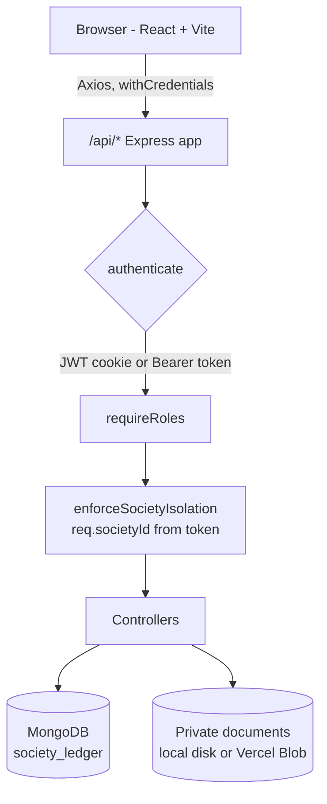
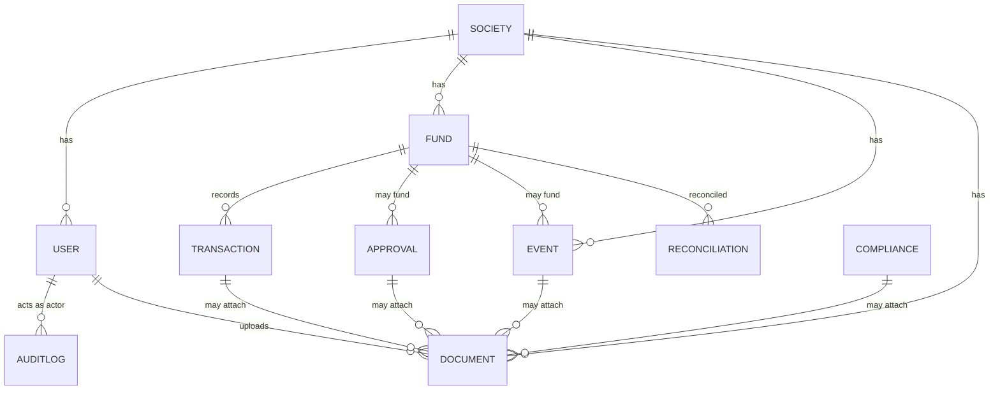

<div align="center">

# 🏢 SocietyLedger

**Financial transparency and governance for apartment communities and Resident Welfare Associations (RWAs).**

[](https://react.dev/)
[](https://vitejs.dev/)
[](https://nodejs.org/)
[](https://expressjs.com/)
[](https://www.mongodb.com/)
[](https://societyledger-rwa-iota.vercel.app)
[](#license)

[**Live Demo**](https://societyledger-rwa-iota.vercel.app) · [**Quick Start**](#quick-start) · [**API Docs**](#api-documentation) · [**Deployment Guide**](VERCEL_DEPLOYMENT_GUIDE.md)

</div>

---

## Table of contents

- [Why SocietyLedger](#why-societyledger)
- [Key features](#key-features)
- [Demo and screenshots](#demo-and-screenshots)
- [Roles and permissions](#roles-and-permissions)
- [Tech stack](#tech-stack)
- [Architecture](#architecture)
- [Project structure](#project-structure)
- [Quick start](#quick-start)
- [Installation guide](#installation-guide)
- [Environment variables](#environment-variables)
- [Available scripts](#available-scripts)
- [API documentation](#api-documentation)
- [Database schema](#database-schema)
- [Authentication and authorization](#authentication-and-authorization)
- [Security highlights](#security-highlights)
- [Deployment](#deployment)
- [Troubleshooting](#troubleshooting)
- [Roadmap](#roadmap)
- [Contributing](#contributing)
- [License](#license)
- [Author](#author)

---

## Why SocietyLedger

Most apartment societies run their money on spreadsheets, chat groups, and trust. Residents rarely see where maintenance funds go, treasurers have no enforced checks on spending, and auditors get paper trails after the fact.

SocietyLedger gives every society one shared, role-aware system:

- **Residents** see published balances, events, and reports, and can ask questions.
- **Treasurers, committee members, auditors, and the Society Administrator** manage funds, vouchers, approvals, compliance, bank reconciliation, and private documents, each within their own permissions.
- **Every record belongs to exactly one society.** A user cannot read or change another society's data.

## Key features

| Area | What you get |
| --- | --- |
| 🔐 **Access control** | Five roles with separate dashboards and route guards, enforced in both the UI and the API |
| 💰 **Funds and vouchers** | Income, expense, and transfer vouchers stored in **integer paise** (1 rupee = 100 paise), so there is no floating-point rounding |
| ✅ **Expense approvals** | Separation of duties: the requester can never approve their own request, and auditors can read but not decide |
| 🎉 **Events** | Proposal, budget approval, vendor quotations, vendor selection, and settlement |
| 🏠 **Resident portal** | Published figures, events, and a question-and-answer channel |
| 📜 **Compliance tracker** | Statutory filings, deadlines, status, and supporting documents |
| 🏦 **Bank reconciliation** | Import statement rows, match them to vouchers, resolve discrepancies, and finalize |
| 🕵️ **Audit trail** | Immutable audit log plus auditor observations |
| 📁 **Private documents** | Upload, role-based download, verification, and delete. Files are never exposed through a public URL |
| ⚙️ **Administration** | Member status and role changes, society profile, and invitation-code rotation |

## Demo and screenshots

**Live app:** <https://societyledger-rwa-iota.vercel.app>

> The live site is the Vercel project `societyledger-rwa`. Sign-in requires an account created in that deployment's database. Local demo accounts are not copied there. New residents can register with the society's invitation code.

### Screenshots

Add images under `docs/screenshots/` and keep these links. The files are not in the repository yet.

| Screen | Preview |
| --- | --- |
| Sign in |  |
| Society Administrator dashboard |  |
| Resident portal |  |
| Funds |  |
| Reports |  |

## Roles and permissions

| Capability | Administrator | Treasurer | Committee | Auditor | Resident |
| --- | :---: | :---: | :---: | :---: | :---: |
| Governance dashboard (`/`) | ✅ | ✅ | ✅ | ✅ | ❌ |
| Resident portal | – | – | – | – | ✅ |
| Create and edit funds | ✅ | ✅ | ❌ | ❌ | ❌ |
| Post and reverse vouchers | ✅ | ✅ | ❌ | ❌ | ❌ |
| Open approval requests | ✅ | ✅ | ✅ | ❌ | ❌ |
| Decide approvals (not own) | ✅ | ✅ | ✅ | ❌ | ❌ |
| Propose and approve events | ✅ | ✅ | ✅ | ❌ | ❌ |
| Settle events | ✅ | ✅ | ❌ | ❌ | ❌ |
| Compliance (read) | ✅ | ✅ | ✅ | ✅ | ❌ |
| Compliance (create and file) | ✅ | ✅ | ❌ | ❌ | ❌ |
| Bank reconciliation | ✅ | ✅ | ❌ | ✅ | ❌ |
| Audit log | ✅ | ❌ | ❌ | ✅ | ❌ |
| Record audit observations | ✅ | ❌ | ❌ | ✅ | ❌ |
| Upload documents | ✅ | ✅ | ✅ | ✅ | ❌ |
| Members, society profile, invitation code | ✅ | ❌ | ❌ | ❌ | ❌ |

Transactions, events, and reports are open to all five roles, with data filtered by role. This matrix is a summary. The API route tables below are the source of truth.

## Tech stack

| Layer | Technologies |
| --- | --- |
| Frontend | React 18.3, React Router 6.28, Vite 5.4, Tailwind CSS 3.4, Axios, Recharts, Lucide icons |
| Backend | Node.js (ES modules), Express 4.21, Helmet, CORS, cookie-parser, express-rate-limit, Morgan |
| Database | MongoDB with Mongoose 8.9 |
| Authentication | JSON Web Tokens (`jsonwebtoken`), bcrypt (`bcryptjs`), HttpOnly cookie `jwt_token` |
| Storage | Local `backend/uploads` in development and on Render; private Vercel Blob in production |
| Deployment | Vercel Services (`vercel.json`), Render blueprint (`render.yaml`) |
| Tooling | Node test scripts in `backend/tests` and `frontend/src/tests` |

## Architecture



1. The React app calls the API with `VITE_API_BASE_URL`. Locally that is `http://localhost:5000/api`. On the single Vercel project it is `/api`, so the browser stays on one origin.
2. Login and registration return a JWT. The API also sets an HttpOnly cookie named `jwt_token`. The browser keeps a copy of the access token **in memory only**. It is never written to `localStorage`.
3. Later requests send the cookie (`withCredentials: true`) or a `Bearer` token. `authenticate` loads the user. `enforceSocietyIsolation` sets `req.societyId` from that user and rejects a mismatched `societyId`.
4. Controllers read and write only that society's documents. Money is stored as integer paise.
5. Successful JSON responses use one envelope:

```json
{
  "success": true,
  "message": "Human-readable result",
  "data": {},
  "errors": null
}
```

Failures use `success: false`, a message, `data: null`, and an `errors` array. Document download is the exception: it streams the file.

### Database relationships

`Society` is the root. Every other collection stores a `society` ObjectId.



The collections that store a `society` reference are: `User`, `Fund`, `Transaction`, `Approval`, `Event`, `Compliance`, `Reconciliation`, `AuditLog`, `Document`, `ResidentQuery`, and `Observation`. Transfer transactions may also point at a second fund.

## Project structure

```text
SocietyLedger/
├── frontend/                 React + Vite client
│   ├── src/pages/            Screens (auth, dashboards, funds, reports, …)
│   ├── src/components/       Layout, form controls, route guard
│   ├── src/context/          Auth, theme, toasts
│   ├── src/services/         Axios client and API helpers
│   ├── src/routes/           Browser router and role gates
│   ├── src/tests/            Frontend integration checks
│   └── .env.example
├── backend/
│   ├── api/index.js          Vercel function entry (no listen)
│   ├── src/server.js         Local and Render process (listen + shutdown)
│   ├── src/app.js            Express app, CORS, cookies, rate limit
│   ├── src/routes/           HTTP routes under /api
│   ├── src/controllers/      Request handlers
│   ├── src/models/           Mongoose schemas
│   ├── src/middleware/       Auth, RBAC, society isolation, errors
│   ├── src/storage/          Local files or private Vercel Blob
│   ├── src/bootstrap/        One-time production society setup
│   ├── src/seeds/seed.js     Local demo data only. Destructive.
│   ├── tests/                Backend test scripts
│   └── .env.example
├── vercel.json               One Vercel project: web + API
├── render.yaml               Optional Render blueprint
├── VERCEL_DEPLOYMENT_GUIDE.md
└── README.md
```

| Path | What it does |
| --- | --- |
| `frontend/src/services/api.js` | Base URL, mock-data switch, cookie credentials |
| `frontend/src/services/apiContract.js` | Role names and which screens each role may open |
| `backend/src/config/db.js` | Mongo connection reuse and the `society_ledger` name rule |
| `backend/src/config/productionEnv.js` | Rejects missing or development secrets in production |
| `backend/src/bootstrap/productionInit.js` | Creates Greenwood Heights and one administrator when confirmed |

## Quick start

Already have Node.js 20+ and MongoDB running locally? Run this in two terminals:

```bash
git clone https://github.com/Varsh2176/SocietyLedger-RWA.git
cd SocietyLedger-RWA

npm install --prefix backend && npm install --prefix frontend
cp backend/.env.example backend/.env && cp frontend/.env.example frontend/.env

npm run seed --prefix backend      # optional, local demo data (destructive)
npm run dev --prefix backend       # terminal 1: API on :5000
npm run dev --prefix frontend      # terminal 2: app on :5173
```

Then open <http://localhost:5173>. Use `localhost`, not `127.0.0.1`, so the session cookie is sent to the API.

> ⚠️ `seed` deletes and recreates local data. Never point it at Atlas or any shared database.

## Installation guide

### Prerequisites

- Node.js 20 or newer
- npm
- MongoDB Community Server running locally, or a MongoDB Atlas cluster

### 1. Clone the repository

```bash
git clone https://github.com/Varsh2176/SocietyLedger-RWA.git
cd SocietyLedger-RWA
```

### 2. Install dependencies

```bash
npm install --prefix backend
npm install --prefix frontend
```

### 3. Configure environment variables

```bash
cp backend/.env.example backend/.env
cp frontend/.env.example frontend/.env
```

On Windows PowerShell, use `Copy-Item` if `cp` is unavailable:

```powershell
Copy-Item backend\.env.example backend\.env
Copy-Item frontend\.env.example frontend\.env
```

Replace the JWT and cookie placeholders in `backend/.env` with long random strings before you share the machine. Leave `MONGODB_URI` on the local address for development.

### 4. Set up the database

Start MongoDB so this address answers:

```text
mongodb://127.0.0.1:27017/society_ledger
```

The API creates the database on first write, and Mongoose creates collections when the first document is saved.

Optional local demo data:

```bash
npm run seed --prefix backend
```

`seed` deletes and recreates local Greenwood Heights data, including users and financial records. Run it only against a local database you are willing to replace.

### 5. Run the backend

```bash
npm run dev --prefix backend
```

The API listens on `http://localhost:5000`. Check `http://localhost:5000/api/health`. A healthy response has `"success": true` and `data.database.status` of `"connected"`.

### 6. Run the frontend

```bash
npm run dev --prefix frontend
```

Open `http://localhost:5173`.

### 7. Run the tests

```bash
npm test --prefix backend
npm test --prefix frontend
```

Backend tests expect local MongoDB at `mongodb://127.0.0.1:27017/society_ledger` and refuse an Atlas URI. If your shell already has a different `MONGODB_URI`, set the local one in the same command, because dotenv does not override an existing variable.

## Environment variables

Copy the examples. **Do not commit real `.env` files.**

### Backend

| Variable | Purpose | Example value |
| --- | --- | --- |
| `PORT` | Port for the local and Render process | `5000` |
| `NODE_ENV` | `development`, `test`, or `production` | `development` |
| `MONGODB_URI` | Mongo connection. Production and Atlas must use database `society_ledger` | `mongodb://127.0.0.1:27017/society_ledger` |
| `JWT_SECRET` | Signs access tokens. Production rejects the example placeholder | `replace-with-a-long-random-jwt-secret` |
| `JWT_EXPIRES_IN` | Token lifetime | `1d` |
| `COOKIE_SECRET` | Signs cookies. Must differ from `JWT_SECRET` | `replace-with-a-long-random-cookie-secret` |
| `CLIENT_URL` | Exact browser origin allowed by CORS | `http://localhost:5173` |
| `UPLOADS_DIR` | Optional private upload directory for local development and Render | `/var/data/uploads` |
| `BLOB_STORE_ID` | Private Vercel Blob store. Required in production when no token is set | `store_example` |
| `BLOB_READ_WRITE_TOKEN` | Blob token for a store that is not using Vercel OIDC | `replace-with-the-private-blob-token` |
| `MONGODB_MAX_POOL_SIZE` | Optional pool size from 1 to 20. Default is 5 | `5` |
| `BOOTSTRAP_CONFIRM` | Must be `INITIALIZE_GREENWOOD_HEIGHTS` before production init | `INITIALIZE_GREENWOOD_HEIGHTS` |
| `CONFIRM_ATLAS_INIT` | Must be `YES` before any Atlas write from bootstrap | `YES` |
| `BOOTSTRAP_ADMIN_NAME` | Initial administrator display name | `Society Administrator` |
| `BOOTSTRAP_ADMIN_EMAIL` | Initial administrator email. Demo `@society.org` addresses are rejected | `admin@example.com` |
| `BOOTSTRAP_ADMIN_PASSWORD` | Initial password, at least 12 characters, not a demo password | `replace-with-a-long-password` |

### Frontend

| Variable | Purpose | Example value |
| --- | --- | --- |
| `VITE_API_BASE_URL` | API origin. A trailing `/api` is optional. Production builds reject localhost | `http://localhost:5000/api` |
| `VITE_APP_NAME` | Application title | `SocietyLedger` |
| `VITE_ENABLE_MOCK_FALLBACK` | Sample figures when the API is down. Ignored in production. Keep `false` | `false` |

Vite reads `VITE_*` variables at build time, so changing them requires a new frontend build.

## Available scripts

| Command | What it does |
| --- | --- |
| `npm run dev --prefix backend` | Start the API locally on port 5000 |
| `npm start --prefix backend` | Start the API the way Render does |
| `npm test --prefix backend` | Run backend tests against local MongoDB |
| `npm run seed --prefix backend` | Reset local demo data (**destructive**) |
| `npm run bootstrap:production --prefix backend` | One-time production society and administrator setup |
| `npm run dev --prefix frontend` | Start the Vite dev server on port 5173 |
| `npm run build --prefix frontend` | Production build of the frontend |
| `npm test --prefix frontend` | Run frontend integration checks |

## API documentation

**Base path:** `/api`

Unless noted, send the session cookie or:

```http
Authorization: Bearer <token>
```

All responses use the [envelope](#architecture) shown above. A query or body `societyId` that does not match the signed-in society returns **403**.

<details>
<summary><b>Health</b></summary>

| Method | Route | Purpose | Request body |
| --- | --- | --- | --- |
| `GET` | `/api/health` | Process and database status. Public. Returns 503 when MongoDB is not connected | None |

Example response:

```json
{ "success": true, "data": { "database": { "status": "connected", "name": "society_ledger" } } }
```

</details>

<details>
<summary><b>Authentication</b></summary>

| Method | Route | Purpose | Request body |
| --- | --- | --- | --- |
| `POST` | `/api/auth/register` | Create a Resident. Role and society id in the body are ignored. Account stays pending verification | `{ "name", "email", "password", "phone", "apartmentNumber", "societyCode" }` |
| `POST` | `/api/auth/login` | Sign in and set `jwt_token` | `{ "email", "password" }` |
| `POST` | `/api/auth/logout` | Clear the cookie | None |
| `GET` | `/api/auth/me` | Current user | None |
| `POST` | `/api/auth/refresh` | Issue a new token for the current session | None |

Example login response:

```json
{ "success": true, "data": { "user": { "role": "Treasurer" }, "token": "<jwt>" } }
```

</details>

<details>
<summary><b>Funds, vouchers, dashboard, and reports</b></summary>

Governance roles can manage funds. Residents see active funds and posted amounts according to the reporting rules in the controllers. Amounts may be sent as rupees (`amount`, `openingBalance`) or integer paise (`amountPaise`, `openingBalancePaise`).

| Method | Route | Who | Purpose | Request body |
| --- | --- | --- | --- | --- |
| `GET` | `/api/funds` | Signed in | List funds for the caller's society | None |
| `GET` | `/api/funds/:id` | Signed in | One fund | None |
| `POST` | `/api/funds` | Administrator, Treasurer | Create a fund. Client `fiscalYear` is ignored | `{ "name", "code", "type", "openingBalance" }` |
| `PATCH` | `/api/funds/:id` | Administrator, Treasurer | Update name, purpose, bank account, or status | `{ "name", "purpose", "status" }` |
| `GET` | `/api/transactions` | Signed in | List vouchers | None |
| `GET` | `/api/transactions/:id` | Signed in | One voucher | None |
| `POST` | `/api/transactions` | Administrator, Treasurer | Post a voucher | `{ "type": "EXPENSE", "description": "Lift repair", "fund": "<fundId>", "amount": 1000, "paymentMethod": "UPI" }` |
| `POST` | `/api/transactions/:id/reverse` | Administrator, Treasurer | Audited reversal | `{ "justification": "Duplicate voucher" }` |
| `GET` | `/api/dashboard/summary` | Signed in | Totals for a period | Query `period` |
| `GET` | `/api/dashboard/charts` | Signed in | Rolling six-month chart, separate from the summary period | Query `period` |
| `GET` | `/api/reports/income-expenditure` | Signed in | Income and expenditure | Query `period` |
| `GET` | `/api/reports/fund-statement` | Signed in | Movement by fund | Query `period` |
| `GET` | `/api/reports/balance-sheet` | Signed in | Balances. Period does not restate the sheet | Query `period` |

**Allowed values**

- Fund `type`: `CORPUS`, `OPERATIONAL`, `SINKING`, `SPECIAL_PROJECT`
- Fund `status`: `ACTIVE`, `SUSPENDED`, `CLOSED`
- Voucher `type`: `INCOME`, `EXPENSE`, `TRANSFER`
- Payment methods: `NEFT_RTGS`, `UPI`, `CHEQUE`, `CARD`, `CASH`

</details>

<details>
<summary><b>Events and approvals</b></summary>

| Method | Route | Who | Purpose | Request body |
| --- | --- | --- | --- | --- |
| `GET` | `/api/events` | Signed in | List events. Residents receive published events only | None |
| `GET` | `/api/events/:id` | Signed in | One event | None |
| `POST` | `/api/events` | Administrator, Treasurer, Committee | Propose an event | `{ "title": "Annual day", "date": "2026-12-01", "proposedBudget": 25000 }` |
| `POST` | `/api/events/:id/approve` | Administrator, Treasurer, Committee | Approve the budget | `{ "approvedBudget": 25000, "resolution": "AGM-12" }` |
| `POST` | `/api/events/:id/quotations` | Administrator, Treasurer, Committee | Add a vendor bid | `{ "name": "Vendor", "quotationRef": "Q-1", "bidAmount": 24000 }` |
| `POST` | `/api/events/:id/select-vendor` | Administrator, Treasurer, Committee | Choose a quotation | `{ "quotationId": "<id>" }` |
| `POST` | `/api/events/:id/settle` | Administrator, Treasurer | Record actual spend and settle | `{ "actualExpenditure": 24000, "settlementNotes": "Paid" }` |
| `GET` | `/api/approvals` | Signed in, role-filtered | List expense requests | None |
| `GET` | `/api/approvals/:id` | Signed in, role-filtered | One request | None |
| `POST` | `/api/approvals` | Administrator, Treasurer, Committee | Open a request. The requester cannot approve it | `{ "description": "Paint", "requestedAmount": 8000, "fund": "<fundId>" }` |
| `POST` | `/api/approvals/:id/decision` | Administrator, Treasurer, Committee (not Auditors) | Approve, reject, or request information | `{ "action": "APPROVED", "comments": "Within budget" }` |

</details>

<details>
<summary><b>Resident portal</b></summary>

| Method | Route | Who | Purpose | Request body |
| --- | --- | --- | --- | --- |
| `GET` | `/api/resident/transparency` | All five roles | Published balances and events. Bank account numbers are masked for residents | None |
| `GET` | `/api/resident/queries` | All five roles | Questions for this society | None |
| `POST` | `/api/resident/queries` | Resident, Committee, Administrator | Ask a question | `{ "category": "MAINTENANCE", "subject": "Water", "question": "When is the tank cleaned?", "unit": "A-101" }` |
| `POST` | `/api/resident/queries/:id/respond` | Committee, Treasurer, Administrator | Answer a question | `{ "response": "First Monday", "newStatus": "ANSWERED" }` |

</details>

<details>
<summary><b>Compliance</b></summary>

Residents cannot open these routes. Committee members can read and attach documents. Creating and filing is limited to the Administrator and Treasurer.

| Method | Route | Purpose | Request body |
| --- | --- | --- | --- |
| `GET` | `/api/compliance/dashboard` | Summary counts | None |
| `GET` | `/api/compliance/export/summary` | Statement export for an AGM or auditor | None |
| `GET` | `/api/compliance` | List tasks | None |
| `GET` | `/api/compliance/:id` | One task | None |
| `POST` | `/api/compliance` | Create a task | `{ "filingType": "TDS return", "statutoryBody": "Income Tax", "financialPeriod": "2026-27", "deadline": "2026-07-31", "deadlineSource": "Statute" }` |
| `PUT` | `/api/compliance/:id` | Update metadata | Task fields |
| `POST` | `/api/compliance/:id/record-filing` | Record a filing | Filing date and acknowledgement fields accepted by the controller |
| `POST` | `/api/compliance/:id/status` | Change lifecycle status | `{ "action": "FILED", "comments": "Acknowledgement uploaded" }` |
| `POST` | `/api/compliance/:id/documents` | Attach a supporting reference | `{ "title": "Challan", "documentType": "RECEIPT", "fileName": "challan.pdf" }` |

</details>

<details>
<summary><b>Reconciliation</b></summary>

Committee members and residents cannot open reconciliation. Readers are Administrator, Treasurer, and Auditor.

| Method | Route | Who writes | Purpose | Request body |
| --- | --- | --- | --- | --- |
| `GET` | `/api/reconciliation` | Readers | List sessions | None |
| `GET` | `/api/reconciliation/:id` | Readers | One session | None |
| `POST` | `/api/reconciliation` | Administrator, Treasurer | Open a session | `{ "fundId", "accountName", "statementPeriodStart", "statementPeriodEnd", "statementClosingBalance" }` |
| `POST` | `/api/reconciliation/:id/import-statement` | Administrator, Treasurer | Import rows | `{ "rows": [], "rawCsvText": "date,amount,narration" }` |
| `POST` | `/api/reconciliation/:id/match` | Administrator, Treasurer, Auditor | Match a row to a voucher | `{ "statementTxId", "ledgerTxId", "notes" }` |
| `POST` | `/api/reconciliation/:id/unmatch` | Same | Remove a match | `{ "statementTxId" }` |
| `POST` | `/api/reconciliation/:id/discrepancies/:discrepancyId/resolve` | Same | Explain a difference | `{ "explanation": "Bank charge", "correctiveAction": "Voucher posted", "status": "RESOLVED" }` |
| `POST` | `/api/reconciliation/:id/finalize` | Same | Lock the session (status becomes `RECONCILED`) | `{ "notes": "Agreed" }` |

</details>

<details>
<summary><b>Audit</b></summary>

| Method | Route | Who | Purpose | Request body |
| --- | --- | --- | --- | --- |
| `GET` | `/api/audit/logs` | Administrator, Auditor | Immutable action log | None |
| `GET` | `/api/audit/observations` | Administrator, Treasurer, Committee, Auditor | Findings list | None |
| `POST` | `/api/audit/observations` | Administrator, Auditor | Record a finding | `{ "title": "Missing invoice", "finding": "Voucher 12 has no invoice" }` |
| `PUT` | `/api/audit/observations/:id` | Administrator, Auditor | Update a finding | Observation fields |

</details>

<details>
<summary><b>Documents</b></summary>

Downloads stay on `/api/documents/:id/download`. The API never returns a public Blob URL, and `storagePath` is omitted from JSON.

| Method | Route | Who | Purpose | Request body |
| --- | --- | --- | --- | --- |
| `GET` | `/api/documents` | All roles. Residents see published files only | List metadata | None |
| `GET` | `/api/documents/:id` | Same visibility rules | Metadata | None |
| `GET` | `/api/documents/:id/download` | Same. Unpublished files return 403 for a resident | Stream the file (`Content-Disposition: attachment`) | None |
| `POST` | `/api/documents` | Committee, Treasurer, Auditor, Administrator | Upload. Allowed extensions: pdf, png, jpg, jpeg, xlsx, csv, txt | `{ "name", "category", "fileName", "mimeType", "fileDataBase64", "isPublishedToResidents": false }` |
| `POST` | `/api/documents/:id/verify` | Auditor, Treasurer, Administrator | Verify or reject | `{ "status": "VERIFIED", "notes": "Matches the voucher" }` |
| `DELETE` | `/api/documents/:id` | Uploader or Society Administrator | Delete metadata and the stored file | None |

**Upload limits:** 10 MB for local and Render. 3 MB for production Blob, so the base64 JSON body stays under the platform limit.

</details>

<details>
<summary><b>Society administration</b></summary>

All `/api/admin` routes require the Society Administrator role.

| Method | Route | Purpose | Request body |
| --- | --- | --- | --- |
| `GET` | `/api/admin/members` | Member directory | None |
| `GET` | `/api/admin/members/:id` | One member | None |
| `PATCH` | `/api/admin/members/:id/status` | Activate or deactivate. The last active administrator cannot be deactivated | `{ "isActive": false }` |
| `PATCH` | `/api/admin/members/:id/role` | Change role. The last active administrator cannot be demoted | `{ "role": "Committee Member" }` |
| `GET` | `/api/admin/society` | Society profile | None |
| `PUT` | `/api/admin/society` | Update profile fields the controller accepts | `{ "contactEmail": "office@example.com" }` |
| `POST` | `/api/admin/invitation-code/rotate` | Replace the registration code | None |

`GET` or `POST` `/api/future-roadmap` returns HTTP 501. It is a reserved path, not a feature.

</details>

## Database schema

**Database name:** `society_ledger`

| Collection | Important fields | Relationships |
| --- | --- | --- |
| `societies` | `name`, `code` (invitation code), `registrationNumber`, `fiscalYearStartMonth`, `isActive`, address and contact | Parent of every other record |
| `users` | `name`, `email` (unique), `passwordHash` (bcrypt, not selected by default), `role`, `verificationStatus`, `isActive`, `apartmentNumber` | `society` → Society. Roles: Society Administrator, Treasurer, Committee Member, Auditor, Resident |
| `funds` | `name`, `code`, `type`, `status`, balances in paise, `bankAccount`, `fiscalYear` | `society` → Society |
| `transactions` | `reference`, `date`, `type`, `status`, `amountPaise`, `paymentMethod`, `description` | `society`, `fund`. Corrections are reversals, not silent edits |
| `approvals` | description, requested amount in paise, `status`, decision history | `society`, optional fund and event. Requester cannot decide their own request |
| `events` | `title`, `date`, `status`, budgets in paise, quotations, selected vendor | `society`, optional funding fund |
| `compliances` | filing type, statutory body, period, deadline, status | `society` |
| `reconciliations` | fund, statement period, balances, imported rows, matches, discrepancies | `society`, `fund` |
| `auditlogs` | `actor`, `action`, `entityType`, `entityId`, `severity`, `details` | `society` |
| `documents` | `name`, `category`, `mimeType`, `sizeBytes`, `storagePath` (hidden), `isPublishedToResidents`, verification | `society`, `uploadedBy`, optional related records |
| `residentqueries` | category, subject, question, status, response | `society`, author |
| `observations` | title, finding, severity, status, recommendation | `society` |

Indexes include unique user email, unique society invitation code, and society-scoped lookups on users. Controllers also reject duplicate fund codes inside one society.

## Authentication and authorization

### Login flow

1. The visitor opens `/login` or `/register`.
2. Registration requires name, email, password (at least 6 characters), phone, apartment number, and the society invitation code (`Society.code`). The new user is always a Resident with verification `PENDING`.
3. Login checks the bcrypt hash. Inactive or rejected accounts are refused.
4. The API signs a JWT containing the user id, role, and society id. Expiry defaults to `1d`.
5. The token is returned in JSON and set as cookie `jwt_token` (`HttpOnly`, `SameSite=Lax`, `Secure` in production, path `/`).
6. The React app stores the token in memory, marks the session active, and sends the user to a role home: residents to `/resident-portal`, other roles to `/`.

Logout clears the cookie and the in-memory token. A 401 on a request from the active session opens the session-expired dialog.

### Protected routes

The UI (`ProtectedRoute`) and the API (`authenticate`, `requireRoles`, `enforceSocietyIsolation`) both enforce access. **Hiding a link is not the security control. The API is.**

| Screen | Roles |
| --- | --- |
| `/` governance dashboard | Administrator, Treasurer, Committee, Auditor |
| `/resident-portal` | Resident |
| `/funds` | Governance roles except Resident |
| `/transactions`, `/events`, `/reports` | All five roles, with data filtered by role |
| `/approvals` | Administrator, Treasurer, Committee |
| `/compliance` | Governance roles except Resident |
| `/reconciliation` | Administrator, Treasurer, Auditor |
| `/audit` | Administrator, Auditor |
| `/settings` | Society Administrator |

Residents who open a governance-only URL return to the resident portal. Other roles see the unauthorized page. An unauthenticated visit goes to `/login`.

## Security highlights

- **Tenant isolation.** The society id comes from the authenticated user, never from the client. A mismatched `societyId` returns 403.
- **Separation of duties.** Requesters cannot approve their own requests, and auditors cannot decide approvals.
- **Tokens stay out of storage.** The access token lives in memory and in an HttpOnly cookie, not in `localStorage`.
- **Production secret checks.** `JWT_SECRET` and `COOKIE_SECRET` must be real, distinct values. Development fallbacks and example placeholders are rejected when `NODE_ENV=production`.
- **Private documents.** Files stream through an authenticated endpoint. There are no public Blob URLs, and unpublished files return 403 to residents.
- **Auditable money.** Amounts are integer paise, and corrections are audited reversals with a justification, not silent edits.
- **Hardened HTTP layer.** Helmet, strict CORS (exact `CLIENT_URL`), and rate limiting (1,000 requests per 15 minutes per API instance).
- **Last-admin protection.** The last active Society Administrator cannot be demoted or deactivated.
- **Destructive scripts are fenced.** Backend tests refuse Atlas URIs, and production bootstrap requires explicit confirmation variables.

## Deployment

Full Vercel steps, health checks, and rollback are in [VERCEL_DEPLOYMENT_GUIDE.md](VERCEL_DEPLOYMENT_GUIDE.md).

### Frontend and backend together on Vercel

`vercel.json` defines one project:

- Service `web` builds `frontend` with Vite and rewrites unknown paths to `index.html`, so a refresh on `/funds` still loads the app.
- Service `api` runs `backend/api/index.js` as Express. It does not call `listen`.
- Public routing sends `/api/*` to the API first, then every other path to the site.
- Functions are set to region `bom1` (Mumbai), next to an Atlas cluster in `ap-south-1`.

**Checklist**

1. Set the API variables from the table above with `NODE_ENV=production`, an Atlas URI whose path is `/society_ledger`, and `CLIENT_URL` equal to the site origin.
2. Connect a **private** Blob store so `BLOB_STORE_ID` is present.
3. For the web build, set:

   ```text
   VITE_API_BASE_URL=/api
   VITE_ENABLE_MOCK_FALLBACK=false
   ```

4. Do **not** add `npm run seed` or `npm run bootstrap:production` to the build.
5. After the API is healthy, initialize production once from `backend` with the confirmation variables set in that shell:

   ```bash
   npm run bootstrap:production --prefix backend
   ```

   This creates Greenwood Heights RWA (`RWA/2021/489`) and one Society Administrator only when they are absent. It does not import local users or financial records. A second run leaves the existing society, invitation code, and password hash unchanged.

### Render

`render.yaml` describes an optional split deployment: Node API `societyledger-api` and static site `societyledger-web`, both in Singapore. The API starts with `npm start`, checks `/api/health`, and stores uploads on a disk at `/var/data`. Applying the blueprint creates services but does not deploy until the blueprint is synced and a deploy is approved. Do not put a real MongoDB URI in `render.yaml`.

### Local production build of the frontend

```powershell
cd frontend
$env:VITE_API_BASE_URL='/api'
$env:VITE_ENABLE_MOCK_FALLBACK='false'
npm run build
```

The build fails if `VITE_API_BASE_URL` is missing or points at `localhost` or `127.0.0.1`.

## Troubleshooting

| Symptom | What to check |
| --- | --- |
| Health returns 503 | MongoDB is not running, or `MONGODB_URI` is wrong. `data.database.name` must be `society_ledger` in production. |
| Production process exits before listen | `validateProductionEnv` prints the missing variable name (never the secret). Set JWT, cookie, client URL, MongoDB, and Blob configuration. |
| Login succeeds and the next call is 401 | The page was opened on `127.0.0.1` while the API is on `localhost`, or `CLIENT_URL` does not exactly match the site origin. |
| Browser shows sample rupee amounts | `VITE_ENABLE_MOCK_FALLBACK` is `true` in development, or the API is unreachable. Production builds ignore the flag. |
| CORS error | `CLIENT_URL` must be the exact origin, including `https` and with no path. |
| Document upload returns 503 | Production Blob is not connected, or the store is public. Create it with private access. |
| Document upload returns 413 | The file plus base64 exceeded the platform body limit. Stay at or below 3 MB in production. |
| Deep link returns a host 404 | The web service rewrite to `/index.html` is missing, or it is ordered ahead of `/api`. |
| `npm test` hits the wrong database | Export `MONGODB_URI=mongodb://127.0.0.1:27017/society_ledger` in the same command. An existing environment variable wins over `.env`. |
| Rate limit (429) | This instance has seen 1,000 requests in 15 minutes. Restarting the local API clears the in-memory counter. |

## Roadmap

- [ ] Email delivery for registration and password reset (there is no reset endpoint today)
- [ ] Pagination and search on the largest lists as societies grow
- [ ] Shared rate-limit store (the current limit is in memory, per API instance)
- [ ] Direct-to-Blob uploads for files larger than the 3 MB production request cap
- [ ] Static outbound addresses for Atlas network rules, instead of a broad allow list
- [ ] Scheduled reminders for compliance deadlines
- [ ] A root `LICENSE` file once the owner chooses a license

## Contributing

Contributions are welcome.

1. Fork the repository and create a branch from `main`.
2. Keep secrets out of Git. Update `.env.example` with placeholders only.
3. Do not run `npm run seed` against a database that holds data you need. Do not run production bootstrap unless you intend to create the Greenwood society.
4. Add or update a test in `backend/tests` or `frontend/src/tests` when you change behavior. Run both test commands before opening a pull request.
5. Describe the user-visible change in the pull request. Do not weaken a test to make the suite pass.

## License

This repository does not include a `LICENSE` file. All rights stay with the copyright holder until a license is added. Do not assume the code is open for reuse, modification, or redistribution.

## Author

**Nelakuditi Varshini**

Repository: <https://github.com/Varsh2176/SocietyLedger-RWA>
